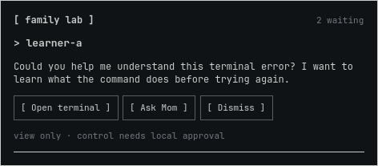
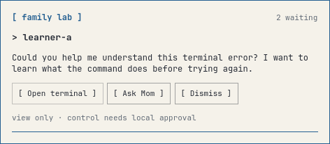

# Omarchy Family Lab

Visible, consent-based terminal assistance for Omarchy PCs on a trusted local network.

**Experimental community shell plugin and CLI.** Not an official Omarchy plugin, not affiliated with or endorsed by the Omarchy maintainers, and not yet validated as a complete multi-PC deployment. The optional inline interface initially targets the inspected Omarchy 4.0 plugin APIs; the native notification/menu backend remains the default.

## Reusable Ask Dad enrollment

The [enrollment guide](docs/ENROLLMENT.md) covers the newer polling deployment: a native screenshot-capable Ask Dad widget, top-right question-mark bar icon, child-consented typing, read-only admin demonstrations and parent-approved Omarchy installs. Start with `./master-installation.sh configure`, then `./master-installation.sh plan` as the helper desktop user. Choose Dad, Mom, or another parent/guardian as the sole helper; labels and command aliases follow that choice. Choose technical help or [approval-only access](docs/APPROVAL_ONLY.md). New technical helpers receive the same quick approve/deny cards by default while keeping private administrator review and teaching tools. Approval-only parents have restricted credentials and graphical decisions backed by a root-owned app worker; additional approval recipients preserve the existing technical helper. Private profiles stay outside Git.

Read the [implementation and verification record](docs/ASSISTANCE_LESSONS.md): individual functions were verified on two PCs, while the new enrollment orchestrator has isolated tests and still needs a clean-machine rollout. It deliberately does not enable the experimental parental policy/PAM/Dino modules. This polling deployment and the older push prototype below are separate installation paths; do not layer their aliases/configuration blindly.

## Original push prototype: what it does

- A learner starts a dedicated tmux learning terminal.
- `ask-dad "Could you help explain this?"` or `ask-mom "Could you help explain this?"` sends a bounded message over independent authenticated SSH routes.
- Dad can click **Ask Mom** on an inline card (or in the native click-through menu), to forward the same live help request using a separately enrolled relay key. Mom receives the learner identity marked **via dad**.
- Optional [themed inline cards](docs/INLINE_UI.md) show **Open terminal**, **Ask Mom** and **Dismiss** directly in a compact monospace interface, using the desktop’s live theme.
- The default native backend remains available: clicking its notification opens **Open terminal / Ask Mom / Close** when forwarding is configured, or the read-only terminal directly otherwise.
- A separate restricted viewing key attaches read-only. The learner can end sharing and disconnect viewers.
- Optional [consented control](docs/CONTROL.md) uses another key, local approval for each connection, a red status indicator, a five-minute maximum grant and a learner revoke shortcut.

Roles describe a workflow, not privileges or family relationships. A learner can be an independent adult administrator or a standard user. A child’s account can remain unprivileged while an adult owns a separate administrator account. Administrator access is separate from this project’s read-only assistance path.

```text
Learner PC ── dedicated notification key ──> helper SSH forced receiver
                                                  |
                                           private bounded queue
                                                  |
                                     watcher in graphical desktop
                                                  |
                                        clickable notification
                                                  |
Helper PC ── separate read-only viewing key ──> learner learning terminal
```

Each learner uses a generic configured peer ID such as `learner-a`. Multiple learners can use separate PCs, accounts and keys. Actual addresses, usernames, host fingerprints and private keys stay on those PCs, outside this repository.

## Start here

1. Read [security boundaries](SECURITY.md) and [architecture](docs/ARCHITECTURE.md).
2. Follow the [staged installation guide](docs/INSTALL.md), stopping at each acceptance gate.
3. Use the [operations guide](docs/OPERATIONS.md) for normal sessions, recovery and removal.
4. For optional hands-on help, read [consented control](docs/CONTROL.md) and enroll a separate control key.
5. Enroll multiple helpers and optional request forwarding with [ROUTING.md](docs/ROUTING.md).
6. For inline buttons and desktop theme integration, follow [INLINE_UI.md](docs/INLINE_UI.md).
7. Check [verification status](docs/VERIFICATION.md) before relying on any capability.

The original user installer does not require root and does not change SSH policy. The opt-in master enrollment separately uses private parent authentication to install root helpers and a locked forced-viewer system account/SSH Match rule; it does not create human accounts, grant child sudo, upgrade packages, reboot or change the firewall. No default keyboard shortcuts or monitor layouts are changed.

**Control remains opt-in.** Notifications and forwarding never approve control; opening the terminal from either path is read-only. Helper requests control with `family-lab assist learner-a`; learner approves locally with `family-lab allow-control`. Ctrl+B then Ctrl+R revokes control without ending the learning session. Control gives a trusted helper the learning account’s shell capabilities; it is not a sandbox.

**Closing or detaching the terminal does not end sharing.** `family-lab stop` ends the dedicated tmux server, disconnects viewers and ends its running jobs. Never type secrets or perform privileged work in a shared terminal.

Synthetic previews using example palettes; the running plugin follows the active desktop theme:





## Development and plugin direction

See [contributing](CONTRIBUTING.md) and the [roadmap](docs/ROADMAP.md). Routing/session logic and their fixed local actions stay separate from the desktop adapter so the current experimental shell plugin can present request actions without handling admin credentials. Broader sharing-state integration and upstream acceptance remain future work.

Published material must contain synthetic examples only. Never contribute private keys, personal configuration, household details, logs, chat transcripts, screenshots with personal information, or hardware inventories.

MIT licensed. No official compatibility or security certification is implied.

## Optional reporting and parental-control roadmap

The experimental [Markdown reporting foundation](docs/REPORTING.md) supports explicit observation imports, separate report-only SSH retrieval, and optional interactive LocalSend sharing. It does not yet collect activity automatically or enforce restrictions. See the [parental-control implementation sequence](docs/PARENTAL_CONTROLS.md) for child-local policy management, monitoring, schedules, filtering, and parent UI plans.

## Experimental child-local controls and private names

The new [parental-control implementation](docs/PARENTAL_CONTROLS.md) includes a child-local root policy service, independent parent authorization, revision conflicts/undo, persistent logged-in time monitoring, optional PAM/session enforcement, a parent terminal menu and a scoped Chromium browser-policy adapter. Nothing is installed automatically. **Actual Omarchy login, service and browser acceptance tests remain required; this is not a production-ready parental-control suite.** DNS filtering, app restrictions, automatic app/site history, graphical policy forms and Notebook import remain unfinished.

Learner IDs are configurable, and [helper-local display names](docs/IDENTITIES.md) can show a person's readable name on the request card while retaining a stable ID. Real names and household files stay out of this public repository.

The [Dino flow prototype](docs/DINO_FLOW.md) adds a themed visual design, bounded save-time presentation and a next-permitted-time forecast. It does not yet replace session termination with secure locking/hibernation or provide a blocked-website page.

The Dino preparation backend now persists finish episodes and exposes a UID-authenticated learner-only action socket. It does not extend the existing logout grace, wire the preview buttons, lock the session or perform hibernation. See [the authority integration limits](docs/DINO_FLOW.md#phase-two-persistent-authority-and-learner-channel) before testing.

Protected work-preserving breaks and bedtime have a separate [enrollment and acceptance guide](docs/PROTECTED_BREAKS.md). New policies stay off until live acceptance.

## Optional upstream activity and filtering integrations

[Optional integration setup](docs/OPTIONAL_INTEGRATIONS.md) adds plan-by-default
ActivityWatch reporting and AdGuard Home choices through `master-installation.sh features`.
ActivityWatch's browser/window/idle streams produce domain-only estimated active-time
reports through the existing report-only SSH role. Upstream ActivityWatch may retain
raw URLs/titles locally; review that disclosure before enabling. AdGuard support currently
registers an existing HTTPS dashboard or generates a reviewed digest-pinned Compose
file, without starting services or changing DNS. Both features remain off by default;
real application installation and machine acceptance are separate steps.
