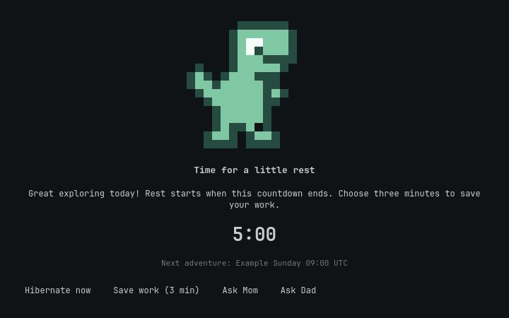

# Dino screen-time experience — phase-one prototype

This change implements the **presentation prototype and next-permitted-time forecast**, not a secure takeover, login greeter, browser extension or hibernation controller. No installed plugin loads it automatically. The existing policy draft still ends expired sessions using `terminate-user`; do not enable that draft expecting it to preserve applications through hibernation.

## Implemented now

- Original mint-green pixel dinosaur drawn in QML code, inspired by a friendly baby-dinosaur style. No external image, remote asset or tracking.
- Theme-bound card states: five-minute warning, time-up/save prompt, saving countdown, blocked and hibernation error. Fixed action signals only: sleep, save, ask-mom and ask-dad.
- A pure presentation model: a five-minute no-response countdown, one explicit three-minute save period from the click, automatic expiry, and no second save action after entering saving/blocked. Asking a parent leaves the countdown running; only an approved exception should change real permission. Choosing save near the end can make the total finish-up period almost eight minutes. This model is not an authorization boundary.
- Policy service `next_allowed` metadata for a blocked learner, using its actual timezone, windows, daily totals and already-approved extra minutes. Real UTC-minute iteration handles missing/repeated local times at DST. The search covers the next eight days; no result is shown as “ask a parent,” not an invented reopening time. Pending requests and future policy changes cannot be predicted.
- New policy defaults use a 180-second grace. **Existing policies retain their configured grace**; this does not migrate a family's allowance or modify installed files.
- Read-only `parental/family-lab-policy hibernation-check` probes logind's CanHibernate. Even “yes” returns `ready_for_family_lab: false`: a real driver/swap/resume test and secure guard integration are still required. It never calls Hibernate, systemctl hibernate, suspend or shutdown.



## Preview and tests

`guardian/preview.qml` is an ordinary window titled **design preview only**. Its timer and buttons modify synthetic in-memory state, never policy. Reloading this demonstration starts its fixture again; it does not demonstrate persistence across reboot or permission to unlock. Its Ask Mom/Dad buttons do not contact anyone. Its Hibernate button does not sleep the PC. It must never be mistaken for a lock screen.

On an installed compatible Omarchy/Quickshell development machine:

```sh
node tests/check_dino_model.cjs
python3 tests/check_next_allowed.py
python3 tests/check_dino_qml.py
```

The last test uses an isolated temporary home/offscreen backend, imports the installed Omarchy Commons/Ui, checks card bounds and saves synthetic time-up/blocked previews if `FAMILY_LAB_PREVIEW_DIR` is set. It performs no power, PAM, enrollment or SSH operation. CI runs the model/calendar/probe tests; it does not have an Omarchy desktop.

## Required next integration

1. Persist a root-authoritative finish episode with a five-minute initial deadline and one available save action. That action may replace the initial deadline with three minutes from its first accepted click, once only. Restart/resume/repeated clicks must not create another grant. Parent-approved exceptions remain separate.
2. Establish a protected lock/resume surface and a restricted fresh-login path. An ordinary fullscreen QML window is dismissible and not enforcement. Authentication must use the real PAM/lock integration; do not collect passwords in this prototype. A correct password must not expose desktop content while policy remains blocked.
3. Add a narrowly authenticated learner action channel for the selected subject. A learner may acknowledge/save/request help, never change limits, approve their own exception or invoke arbitrary root power commands. Display actions only for actually enrolled helper routes.
4. Replace termination only behind an explicit verified end-action choice. On the child's dedicated PC, lock before hibernating, then check policy again before unlocking on resume. Do not close the session first. If hibernation fails, retain the protected surface and report the error; no silent poweroff fallback. Never hibernate Mom's adult workstation as a side effect of her helper role.
5. Test actual GTX 1050 Ti hibernate/resume, encrypted swap/resume configuration, normal password authentication, screen privacy during transitions, PC waking before/after permitted time, offline parents, clock/DST changes and local admin recovery. CanHibernate alone is insufficient.
6. Implement the matching website page separately through a reviewed browser integration. Chromium URLBlocklist remains authoritative until a tested adapter can present the friendly page without bypassing enforcement or inspecting page contents/search terms. No custom website page is implemented here.

## Planned wake behavior

Before sleeping, the protected guard must already cover the learner session. Waking during blocked hours must return to that guard, showing the next permitted date/time, Hibernate now and the enrolled Ask Mom/Dad actions. A correct account password confirms identity; it does not grant more screen time. The desktop must remain concealed until both authentication and current policy allow access. Resume is an existing session, so a fresh-login PAM check alone does not provide this.

Each genuine wake during blocked hours starts a fresh five-minute countdown on the protected screen, then requests hibernation again if access is still blocked. Hibernate now acts immediately. Asking Mom/Dad sends a request while the countdown continues; a button click alone does not grant unlimited awake time or desktop access. The production controller must distinguish a genuine wake from restarting the UI so repeated launches cannot reset this timer.

The same finish episode survives wake/restart: waking must not provide another three-minute save option. Parent approval can allow an exception. If the next session is already permitted, normal authentication can restore access. This behavior, including actual automatic hibernation, still requires the protected guard and hardware acceptance tests above; the preview only changes its displayed phase. The `wakeBlocked` model fixture and rendered blocked card demonstrate the five-minute wake countdown without listening for actual wake events or issuing power commands.

## Wording and guarantees

Use “Save your adventure” and “Your saved files are still on this PC.” Do not promise unsaved work survives, or call an Omarchy filesystem snapshot a saved desktop session. Hibernation captures memory; filesystem recovery snapshots do not substitute for it. Avoid blame or punishment messages. Display the exact next date/time and timezone only when the policy forecast supplies it; otherwise ask a parent.

Hardware guidance: [Omarchy system sleep](https://omarchy.org/manual/system-sleep/), [Linux hibernation](https://www.kernel.org/doc/html/latest/admin-guide/pm/sleep-states.html#hibernation). No hibernation setup commands were run while creating this prototype.
